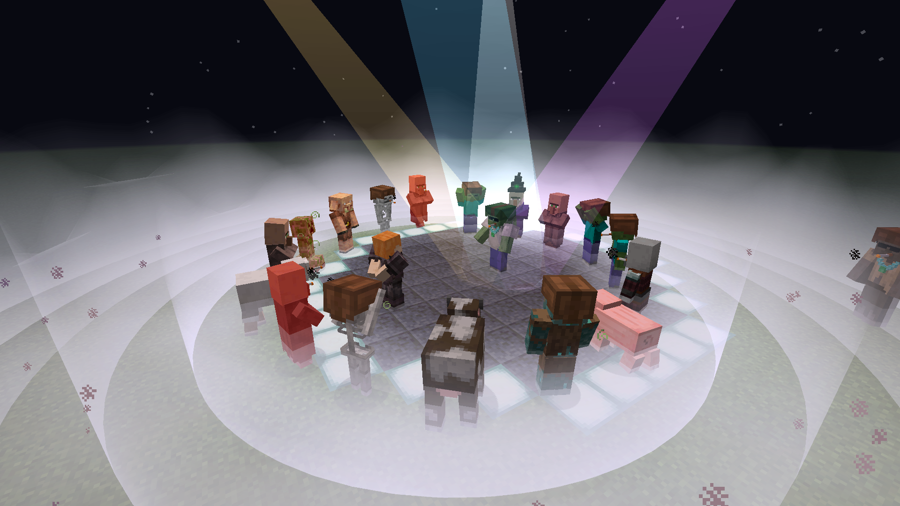
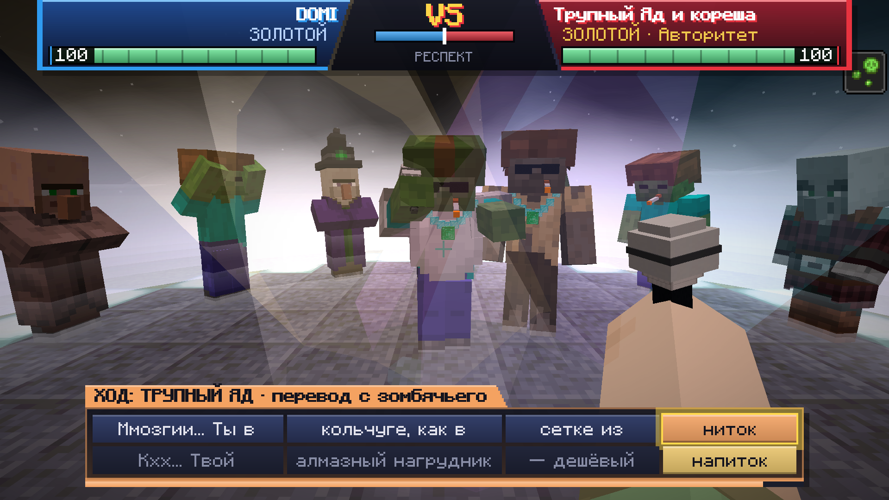
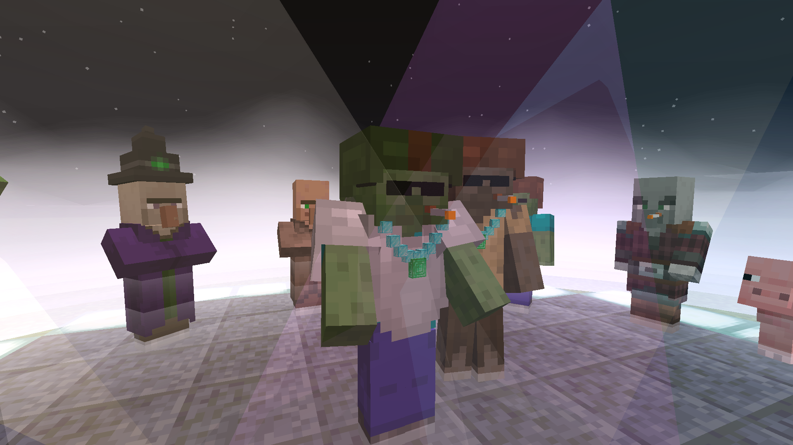
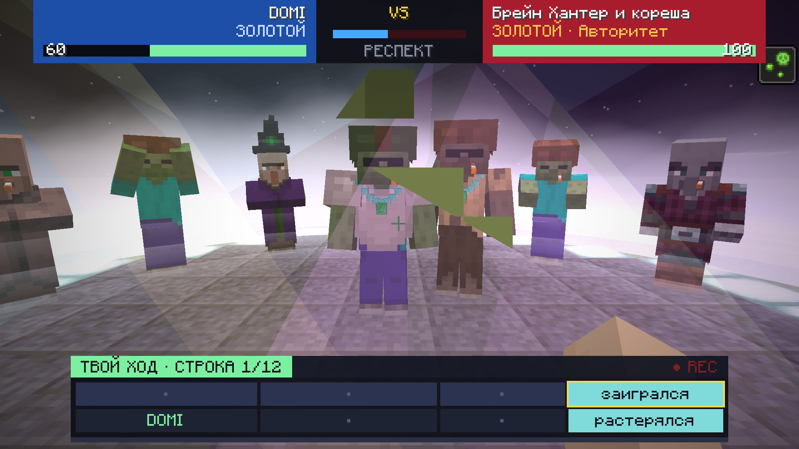
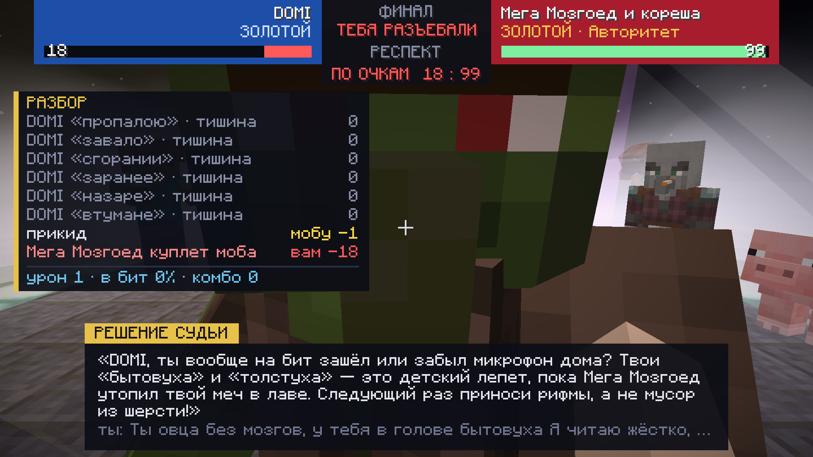

# Rap Battle: рэп-баттлы с мобами и друзьями (Fabric 1.21.11)

Бьёшь моба пустой рукой, и он вызывает тебя на баттл. Играет настоящий бит, моб зачитывает куплет (его пишет
нейросеть), потом читаешь ты: **голосом в микрофон**, заканчивая каждую строку словом из цветной клетки.
Нейросеть-судья разбирает каждую строку, полоски Респекта отщёлкиваются, толпа вокруг орёт, свистит и освистывает.



| | |
|---|---|
|  |  |
|  |  |

## Откуда мод
Увидел такую идею где-то в ТикТоке и пошёл искать мод. Не нашёл ни на Modrinth, ни на CurseForge,
ни на других площадках, поэтому решил сделать его сам.

Делал я его для себя и друзей, а выкладываю, чтобы и вы могли пофаниться со своими. Это не какой-то
суперсерьёзный проект, так что без фанатизма.

**Нашёл баг?** Пиши сразу в [Issues на GitHub](https://github.com/DOMIOMI/rapbattle/issues): что делал, что
случилось, версия мода и, если есть, файл `logs/latest.log`. Постараюсь исправить в ближайшее время.

> **Честно предупреждаю:** мод целиком написан ИИ (Claude), я это не скрываю. Я придумывал, тестировал
> и говорил, что поправить, а код писала нейросеть. Биты, голоса толпы и выкрики тоже сделаны нейросетями
> (ElevenLabs). Этот текст тоже написал Claude. Если для тебя это важно, теперь ты знаешь.

## Что есть
- **Баттлы с любым мобом**: ранги от Кожаного до Незеритового, боссы в три раунда, банды, клички, дресс-код.
- **Баттлы игрок против игрока**: ударь друга пустой рукой, он принимает вызов кнопкой **Y**.
- **Кооп**: друзья рядом вписываются в твой баттл.
- **Респект и урон**: полоски как в файтинге, комбо, нокаут или победа по очкам, разбор судьи по строкам.
- **Честный «в бит»**: распознавание отдаёт время каждого слова, и мод проверяет, прозвучала ли рифма на своей доле.
- **Настоящие биты** (9 треков, сгенерированы ElevenLabs Music), **живая толпа** с голосами, выкриками, свистом.
- **Анимации**: игроки читают с микрофоном и танцуют (Player Animation Library внутри мода), мобы двигаются под бит.
- **Калибровка задержки** микрофона и **клипы**: после куплета в чате кнопка «Сохранить клип» (или `/rapbattle clip`), и твой куплет под бит ложится в WAV в папку `rapbattle-clips`.
- **Соперники с памятью**: моб помнит, кого победил или кому проиграл, и на реванше припоминает твои строки.

## Установка
1. Minecraft **1.21.11**, Fabric Loader **0.18.6+**, **Fabric API**.
2. Положи `rapbattle-<версия>.jar` в папку `mods`. Всё остальное (анимации, звуки) уже внутри.
3. Необязательно: **Mod Menu**, тогда настройки откроются из списка модов. Без него: команда `/rapbattle`.

В мультиплеере мод нужен и на сервере, и у всех игроков. Ключи нужны **только на сервере**
(в одиночной игре сервер — это твой компьютер).

## Ключи
Открой настройки (`/rapbattle` или Mod Menu) → **Ключи API**. Там видно, введены ли ключи, их можно вписать
и проверить кнопкой «Проверить». Ключи сохраняются в `config/rapbattle-server.json` и никуда, кроме самих
сервисов, не отправляются.

| Ключ | Зачем | Где взять |
|---|---|---|
| OpenRouter | куплеты мобов и судья (по умолчанию `deepseek/deepseek-v4-flash`, меньше цента за баттл) | openrouter.ai/keys |
| Groq | распознавание голоса (Whisper), бесплатно | console.groq.com/keys |

Без ключей мод тоже работает: мобы читают заготовленные куплеты, а судья оценивает игру «на слух».

На своём сервере ключи можно задать переменными окружения: `OPENROUTER_API_KEY`, `RAPBATTLE_STT_KEY`. Хочешь Claude или другую модель — укажи её в `openRouterModel` (OpenRouter отдаёт почти все).

> **Не выкладывай** `config/rapbattle-server.json` и не отдавай сборку вместе с ним: в нём твои ключи.

## Как играть
- **Вызов моба:** удар пустой рукой → выбор **R** (баттл) или ещё удар (драка).
- **Вызов игрока:** удар пустой рукой по игроку → он жмёт **Y** (принять) или **N**.
- **Отсчёт 4-3-2-1**, ход соперника, такт «ГОТОВЬСЯ», потом твои строки. Жёлтая точка идёт по долям,
  на 4-й доле должна прозвучать рифма из цветной клетки.
- **Если рифмы не засчитываются «в бит»:** настройки → «Задержка» → пройди калибровку (похлопай под щелчки).
- Громкость толпы — ползунок «Дружелюбные существа» в настройках звука игры.

## Сборка
```
gradlew build
```
JDK 21 Gradle скачает сам. Готовый jar: `build/libs/`.

Генераторы звуков и анимаций лежат в `tools/` (нужен ключ ElevenLabs для звуков; готовые файлы уже в репозитории).

> `gradlew runClient` (dev-запуск игры) не работает из папки с кириллицей в пути. Это баг dev-лаунчера Fabric,
> на собранный jar он не влияет. Для dev-запуска скопируй проект в путь только из латиницы, например `C:\dev\rapbattle`.

## Звуки
Биты, голоса толпы и выкрики сгенерированы через ElevenLabs (Music, Sound Effects, Text to Speech) на платном
тарифе автора мода.

## Что внутри jar
- [Player Animation Library](https://modrinth.com/mod/player-animation-library) (MIT): анимации игроков.

## Лицензия

MIT — см. файл [LICENSE](LICENSE). Звуки и биты в `assets/rapbattle/sounds` сгенерированы через ElevenLabs.

Если по-простому: бери мод, включай в свои сборки, переделывай, выкладывай свои версии. Спрашивать
разрешения не надо, только оставь файл LICENSE с указанием автора (DOMI).
