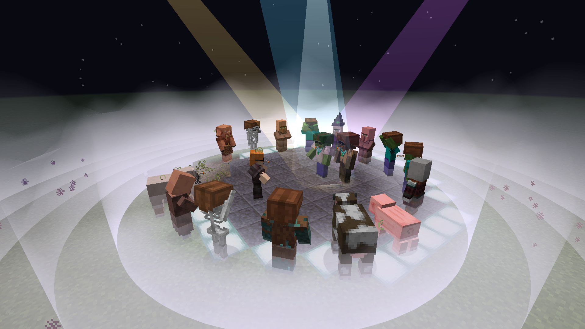
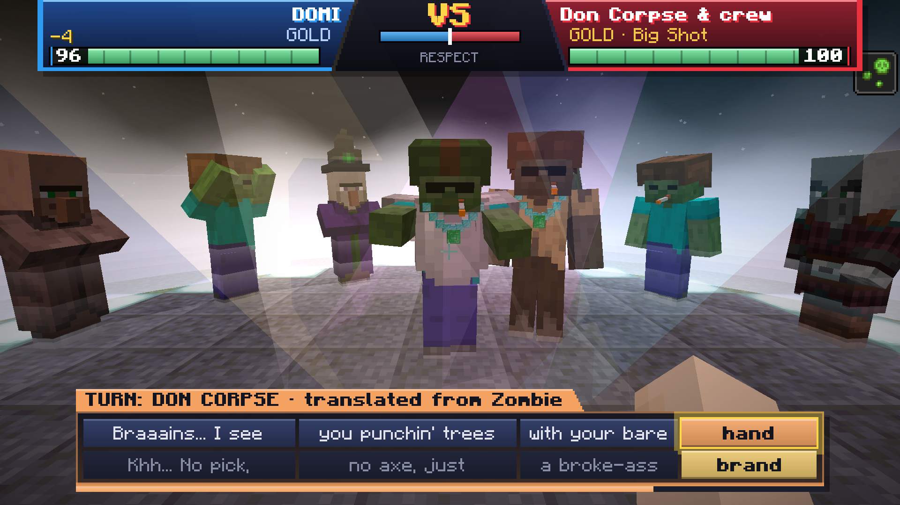
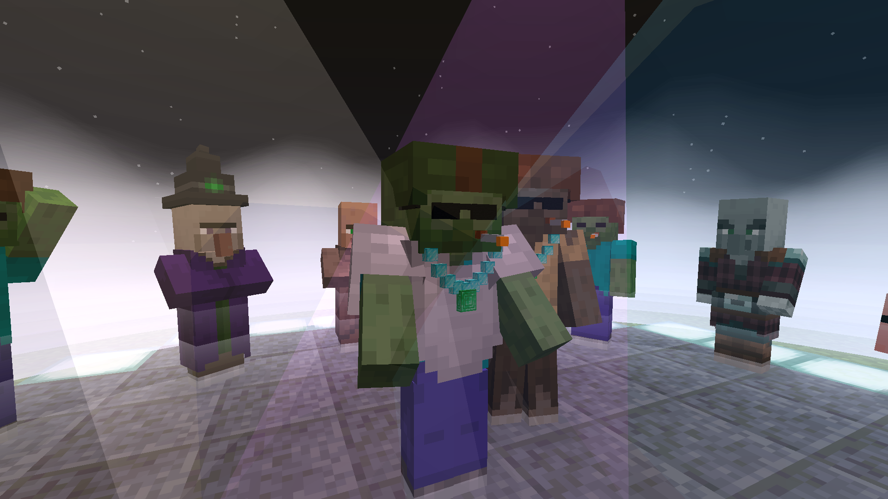
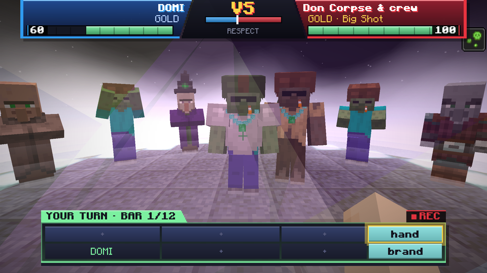
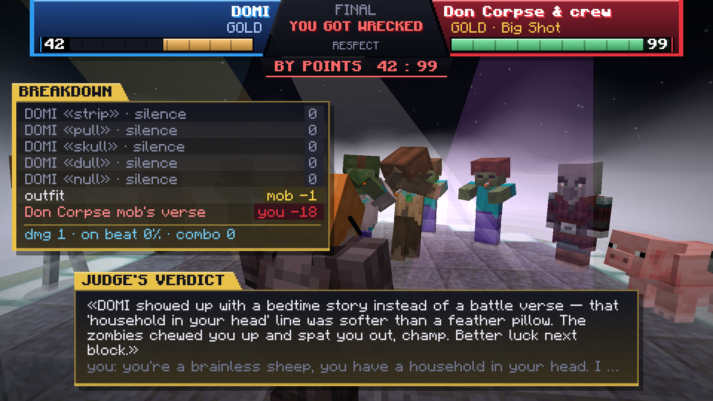

# Rap Battle: rap battles against mobs and friends (Fabric 1.21.11)

🇷🇺 [Русская версия](README.md)

Punch a mob with an empty hand and it challenges you to a battle. A real beat drops, the mob spits a verse (written
by an AI), then it's your turn: rap **with your voice into the microphone**, ending each line with the word from the
coloured cell. An AI judge breaks down every line, the Respect bars tick away, and the crowd around you yells,
whistles and boos.



| | |
|---|---|
|  |  |
|  |  |

> ⚠️ **Online play is not fully tested yet.** Singleplayer is tested. Multiplayer (two real players over the
> network, players with different game languages, on-beat detection with Groq speech recognition) will be
> tested in the next few days. The Modrinth and CurseForge release comes after that.

## Why this mod exists
I saw the idea somewhere on TikTok and went looking for a mod. Couldn't find one on Modrinth, CurseForge or anywhere
else, so I decided to make it myself.

I made it for myself and my friends, and I'm putting it out so you can have fun with yours too. It's not some
super-serious project, so take it easy.

**Found a bug?** Report it right away in [GitHub Issues](https://github.com/DOMIOMI/rapbattle/issues): what you did,
what happened, the mod version and, if you have it, the `logs/latest.log` file. I'll try to fix it as soon as I can.

> **Fair warning:** this mod was written entirely by AI (Claude), and I'm not hiding it. I came up with the ideas,
> tested it and said what to fix, while the code was written by the AI. The beats, crowd voices and shouts were also
> made with AI (ElevenLabs). This text was written by Claude too. If that matters to you, now you know.

## Features
- **Battles with any mob**: ranks from Leather to Netherite, three-round boss fights, gangs, nicknames, a dress code.
- **Player vs player battles**: punch a friend with an empty hand, they accept the challenge with **Y**.
- **Co-op**: friends nearby can join your battle.
- **Respect and damage**: fighting-game style bars, combos, knockout or win on points, a line-by-line judge breakdown.
- **Honest "on beat" check**: speech recognition returns the timing of every word, and the mod checks whether the rhyme landed on its beat.
- **Real beats** (9 tracks, generated with ElevenLabs Music), a **live crowd** with voices, shouts and whistling.
- **Animations**: players rap with a microphone and dance (Player Animation Library bundled in the mod), mobs move to the beat.
- **Microphone latency calibration** and **clips**: after your verse a "Save clip" button appears in chat (or use `/rapbattle clip`), and your verse over the beat is saved as a WAV in the `rapbattle-clips` folder.
- **Rivals with memory**: a mob remembers who it beat or lost to, and throws your old lines back at you in a rematch.
- **Russian and English**: the language follows each player's Minecraft language (Russian for Russian, English for everything else). In a battle between players with different languages, the challenger's language is used.

## Installation
1. Install Minecraft **1.21.11** with [Fabric Loader](https://fabricmc.net/use/installer/) **0.18.6+**.
2. Download [Fabric API](https://modrinth.com/mod/fabric-api/versions?g=1.21.11) for 1.21.11 into the `mods` folder.
3. Download the mod: **[rapbattle-0.2.0.jar](https://github.com/DOMIOMI/rapbattle/releases/download/v0.2.0/rapbattle-0.2.0.jar)**
   (all versions on the [Releases](https://github.com/DOMIOMI/rapbattle/releases) page) into `mods` too.
   Everything else (animations, sounds) is already inside.
4. Optional: [Mod Menu](https://modrinth.com/mod/modmenu/versions?g=1.21.11), so the settings open from the mod
   list. Without it: the `/rapbattle` command.

In multiplayer the mod is needed both on the server and by every player. Keys are needed **only on the server**
(in singleplayer the server is your own computer).

## Keys
Open the settings (`/rapbattle` or Mod Menu) → **API Keys**. There you can see whether the keys are set, enter them
and test them with the "Check" button. Keys are saved in `config/rapbattle-server.json` and are never sent anywhere
except the services themselves.

| Key | What for | Where to get it |
|---|---|---|
| OpenRouter | mob verses and the judge (default `deepseek/deepseek-v4-flash`, less than a cent per battle) | openrouter.ai/keys |
| Groq | voice recognition (Whisper), free | console.groq.com/keys |

The mod works without keys too: mobs rap pre-written verses, and the judge rates the performance "by ear".

On your own server you can set the keys with environment variables: `OPENROUTER_API_KEY`, `RAPBATTLE_STT_KEY`. Want Claude or another model? Set it in `openRouterModel` (OpenRouter serves almost all of them).

> **Don't publish** `config/rapbattle-server.json` and don't share a build together with it: it contains your keys.

## How to play
- **Challenge a mob:** punch it with an empty hand → choose **R** (battle) or punch again (fight).
- **Challenge a player:** punch a player with an empty hand → they press **Y** (accept) or **N**.
- **Countdown 4-3-2-1**, your opponent's turn, a "GET READY" bar, then your lines. A yellow dot moves across the beats,
  and the rhyme from the coloured cell must land on the 4th beat.
- **If your rhymes don't count as "on beat":** settings → "Latency" → run the calibration (clap along to the clicks).
- Crowd volume is the "Friendly Creatures" slider in the game's sound settings.

## Building
```
gradlew build
```
Gradle downloads JDK 21 by itself. The finished jar: `build/libs/`.

The sound and animation generators are in `tools/` (sounds need an ElevenLabs key; the generated files are already in the repository).

> `gradlew runClient` (dev launch of the game) doesn't work from a folder with Cyrillic characters in the path. This is
> a bug in Fabric's dev launcher and doesn't affect the built jar. For a dev launch, copy the project to a Latin-only path, e.g. `C:\dev\rapbattle`.

## Sounds
The beats, crowd voices and shouts were generated with ElevenLabs (Music, Sound Effects, Text to Speech) on the mod
author's paid plan.

## What's inside the jar
- [Player Animation Library](https://modrinth.com/mod/player-animation-library) (MIT): player animations.

## License

MIT — see the [LICENSE](LICENSE) file. The sounds and beats in `assets/rapbattle/sounds` were generated with ElevenLabs.

In plain words: take the mod, put it in your modpacks, change it, publish your own versions. No need to ask for
permission, just keep the LICENSE file with the author credit (DOMI).
