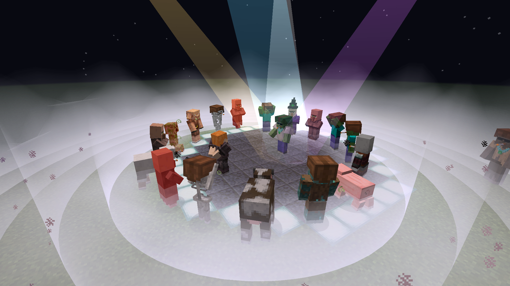
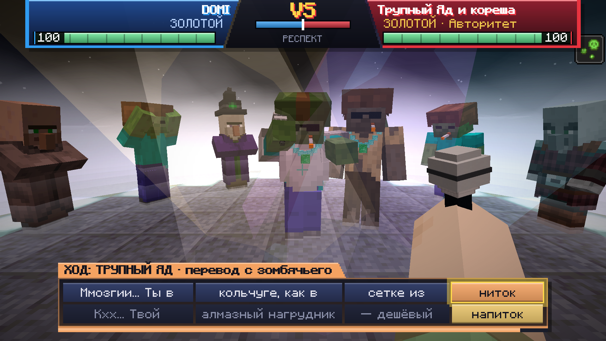
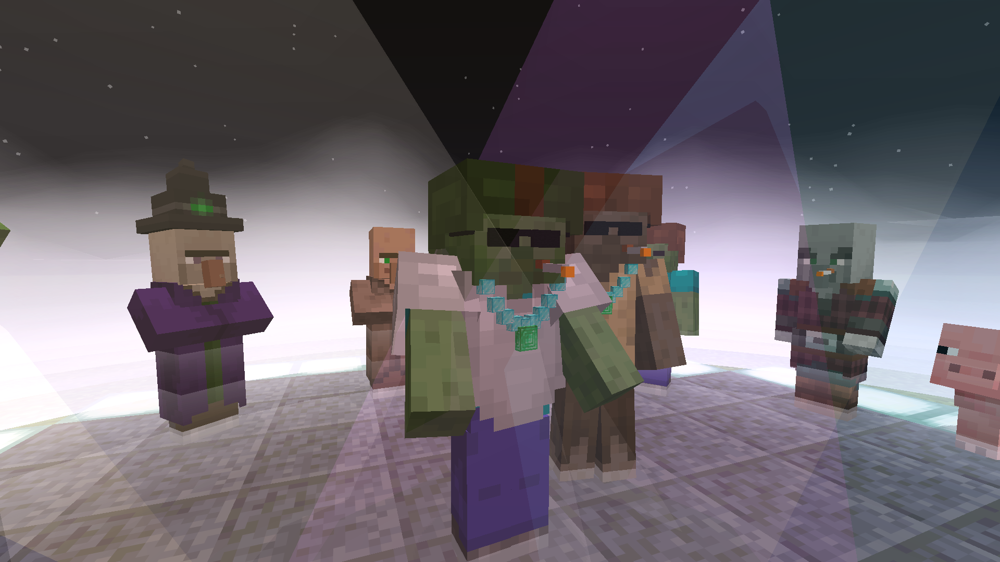
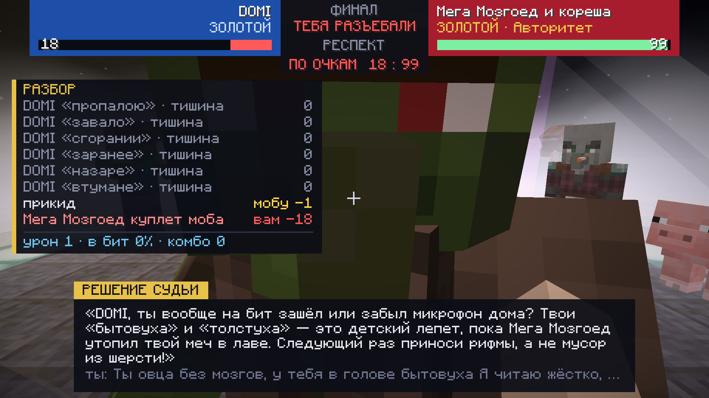

<!-- Текст для страницы на Modrinth / CurseForge. Короткое описание (summary):
Рэп-баттлы с мобами и друзьями: читаешь голосом в микрофон под настоящий бит, нейросеть пишет ответ и судит, толпа орёт.
-->

# Rap Battle — рэп-баттлы с мобами

Бьёшь моба пустой рукой, и он вызывает тебя на баттл. Вокруг собирается толпа, загораются прожекторы, стелется
дым, играет бит. Моб зачитывает куплет, потом твоя очередь: читаешь **голосом в микрофон** и заканчиваешь
каждую строку рифмой из цветной клетки. Судья разбирает каждую строку, полоски Респекта тают, толпа свистит
или орёт за тебя. Проиграл — теряешь от 2 до 5 сердец.

## Откуда мод
Увидел такую идею где-то в ТикТоке и пошёл искать мод. Не нашёл ни на Modrinth, ни на CurseForge, ни на других
площадках, поэтому решил сделать его сам.

Делал я его для себя и друзей, а выкладываю, чтобы и вы могли пофаниться со своими. Это не какой-то
суперсерьёзный проект, так что без фанатизма.

**Нашёл баг?** Пиши сразу в [Issues на GitHub](https://github.com/DOMIOMI/rapbattle/issues): что делал, что
случилось, версия мода и, если есть, файл `logs/latest.log`. Постараюсь исправить в ближайшее время.

> **Честно предупреждаю:** мод целиком написан ИИ (Claude), я это не скрываю. Я придумывал, тестировал и говорил,
> что поправить, а код писала нейросеть. Биты, голоса толпы и выкрики тоже сделаны нейросетями (ElevenLabs).
> Этот текст тоже написал Claude.

## Что умеет
- **Баттл с любым мобом.** Ранги от Кожаного до Незеритового, боссы в три раунда, банды, клички, моб
  комментирует твой шмот.
- **Игрок против игрока.** Ударь друга пустой рукой, он принимает вызов кнопкой **Y**. Работает по LAN и на сервере.
- **Респект и урон** как в файтинге: комбо, нокаут или победа по очкам, разбор судьи по каждой строке.
- **Честный «в бит».** Мод знает, когда прозвучало каждое слово, и проверяет, попала ли рифма на долю.
- **9 энергичных битов** и **живая толпа**: стоит кругом, качается под бит, свистит, поддерживает, выкрикивает фразы.
- **Сцена:** прожекторы, плотный туман, у мобов цепи, очки, кепки и сигареты с дымом.
- **Анимации:** игрок читает с микрофоном и танцует, мобы двигаются под бит.
- **Соперники с памятью:** на реванше моб припомнит, чем ты его уделал.
- **Клипы:** твой куплет под бит сохраняется в WAV одной кнопкой.
- **Калибровка задержки** микрофона и экран настроек с ключами (через Mod Menu или `/rapbattle`).

## Что нужно
- Minecraft **1.21.11**, Fabric Loader **0.18.6+**, **Fabric API**. Mod Menu — по желанию.
- Микрофон.
- Два ключа API (вписываются в настройках мода → «Ключи API»):
  - **OpenRouter** — куплеты мобов и судья, меньше цента за баттл;
  - **Groq** — распознавание голоса, бесплатно.
- Без ключей мод тоже работает: мобы читают заготовленные куплеты, судья оценивает «на слух».

В мультиплеере мод нужен на сервере и у всех игроков, ключи — только на сервере.
Мод поддерживает **русский и английский** языки: язык выбирается по языку клиента Minecraft каждого игрока (в баттле с игроками на разных языках используется язык того, кто вызвал баттл).

## Можно брать
Лицензия MIT. Бери мод, включай в свои сборки, переделывай, выкладывай свои версии. Спрашивать не надо,
только оставь файл LICENSE с указанием автора (DOMI).

Исходники и баг-репорты: https://github.com/DOMIOMI/rapbattle

---

**English, briefly:** rap battles against mobs and friends. You rap into your microphone over a real beat, an LLM
writes the mob's verse and judges every line, the crowd cheers or boos. Supports both **English and Russian**
(automatically follows each player's Minecraft language).
Fully AI-written (Claude), this description included; beats and crowd voices made with ElevenLabs. MIT: use it in modpacks, fork it, change it.
A just-for-fun project made for friends. Found a bug? Open an issue on GitHub: https://github.com/DOMIOMI/rapbattle/issues
